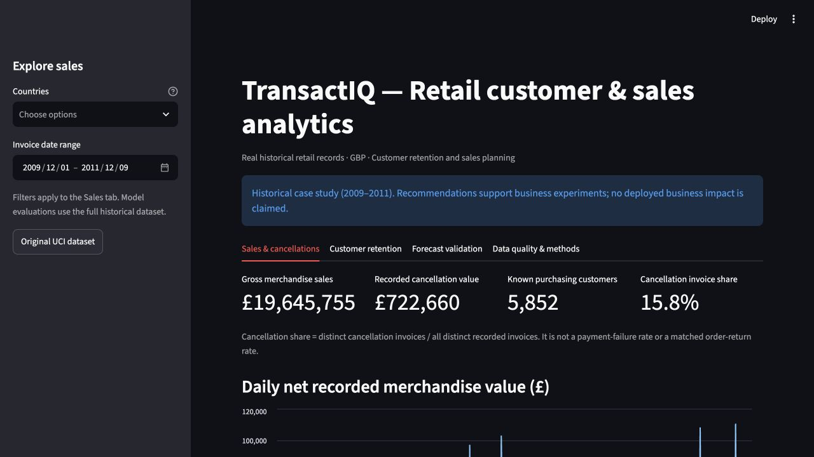
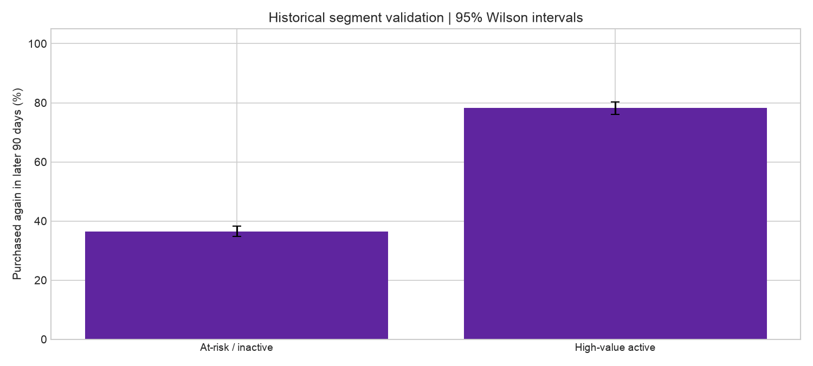
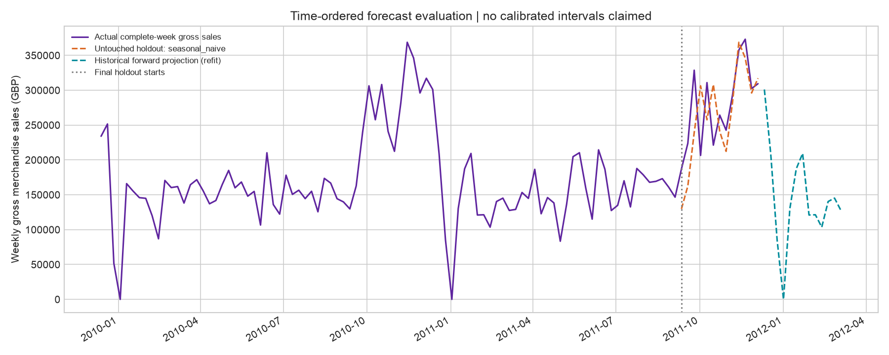

# TransactIQ — Customer Retention & Sales Analytics

An end-to-end analytics case study using **real retail invoice records**, built to answer:

- Which customers should a retailer prioritize for loyalty and re-engagement experiments?
- Do customer segments built from earlier purchases distinguish later repeat purchasing?
- How accurately can weekly sales be forecast compared with simple baselines?
- Where are recorded cancellations concentrated, and how do customer cohorts retain?

**Python · SQL/SQLite · pandas · scikit-learn · Streamlit · pytest**

## Real data, honest scope

The source is [UCI Online Retail II](https://archive.ics.uci.edu/dataset/502/online+retail+ii): **1,067,371 invoice line items** from a UK online retailer between December 2009 and December 2011. A line item is not a distinct order. Prices and reports use **GBP**, not INR.

This is an offline historical analysis, not a deployed commercial system. Recommendations address real retail decisions; improvements in retention, sales or cost have **not** been measured. The original simulated payments files are archived in `legacy/synthetic/` and never enter this pipeline.

See [generated findings](reports/findings.md) for actual results, including the selected model's held-out performance and limitations. Do not reuse the old synthetic project's numbers.

## Results from the verified run

| Measure | Result |
|---|---:|
| Original invoice line items | 1,067,371 |
| Retained merchandise lines | 1,021,434 |
| Audited exclusions | 45,937 |
| Known customers in the latest 365-day segmentation window | 4,261 |
| Later 90-day purchase rate: high-value active segment | 78.3% |
| Later 90-day purchase rate: at-risk / inactive segment | 36.5% |
| Selected weekly sales model | Same-week-last-year baseline |
| Final 13-week holdout WAPE | 15.6% |

The segment rates describe different historical groups, not an improvement caused by this project. The seasonal baseline beat the trend regressions on both earlier validation and final holdout data.







## Run locally

Python **3.12 or newer** is recommended. From this repository:

```bash
python3 -m venv .venv
source .venv/bin/activate
pip install -r requirements.txt

# Downloads the original ~44 MB UCI archive on first use; imports both year sheets.
# Excel parsing can take a few minutes.
python src/pipeline.py

# Browse the completed analysis.
streamlit run src/dashboard.py

# Offline tests use small controlled fixtures, never download the UCI dataset.
pytest -q
```

If you already have the original workbook/archive:

```bash
python src/pipeline.py --source /absolute/path/online_retail_II.xlsx
# Regenerate analysis and charts without re-reading Excel:
python src/pipeline.py --reuse-db
```

The dashboard only reads completed data and reports; it never silently rebuilds or downloads a dataset. The source archive and generated SQLite database are excluded from Git. `requirements-lock.txt` records the environment used for the verified local run; `requirements.txt` declares compatible dependency ranges.

## Pipeline and data quality

1. **Source ingestion:** Download the original UCI ZIP, read all workbook sheets, record the source URL and archive SHA-256.
2. **Reconciliation:** Assign mutually exclusive exclusion reasons. Source rows = retained rows + excluded rows. Report invalid dates, missing invoice/product identifiers, invalid quantities, zero/invalid prices, non-merchandise adjustment codes and exact duplicates. Audited excluded rows are saved locally.
3. **Database:** Create `customers`, `products` and `invoice_lines` with checks, foreign keys and indexes. Reconcile persisted count and integer-pence totals. Build a temporary database and replace the previous database only after successful validation; reruns do not append duplicates.
4. **SQL analysis:** Export monthly sales/MoM growth, country and product sales, cancellation hotspots, adjacent-month retention, first-purchase cohorts and anonymous-sales coverage.
5. **Customer models:** Fit RFM segmentation and validate earlier segments on later purchases.
6. **Forecast evaluation:** Use earlier rolling validation to select a model, evaluate once on the final holdout, then refit on all complete weeks for a historical forward projection.
7. **Presentation:** Export reproducible CSV/JSON reports, static figures and a filterable Streamlit dashboard.

### Important cleaning decisions

- **Missing customer IDs:** Keep valid lines in sales and cancellation totals; exclude them from customer segmentation and retention analysis. IDs are not imputed or invented.
- **Exact duplicates:** Remove identical source rows. The dataset has no reliable line identifier to distinguish an accidental duplicate from an identical legitimate item entry. This assumption can affect totals and is disclosed in the audit.
- **Cancellations:** Invoice numbers beginning with `C` or negative quantities are cancellation/return-like records. Sign their merchandise amounts negative. They cannot reliably be matched to original sales and are **not failed payments**.
- **Non-merchandise adjustments:** Explicitly exclude accounting/fulfilment codes such as `POST`, `D`, `M`, `BANK CHARGES` and `DOT`. The full list is in `src/prepare_data.py`; exclusions are audited, not relabeled as products.
- **Money:** Calculate each line as `abs(quantity) × unit_price`, round to pence, then apply cancellation sign. Gross merchandise sales exclude cancellation lines. Net recorded merchandise value subtracts recorded cancellations; neither metric represents audited revenue or profit.
- **Descriptions:** Missing descriptions use `Unknown`. Product descriptions can vary, so the product dimension uses the last observed description for display.
- **Outliers:** High-value valid merchandise records are retained rather than silently trimmed. Gross sales can therefore be volatile.

## Segmentation and later-purchase validation

RFM uses positive merchandise purchase records in the **365 days before an analysis cutoff**:

- **Recency:** Days from the cutoff to the most recent purchase.
- **Frequency:** Number of distinct purchase invoices, not line items.
- **Monetary:** Gross purchase value in GBP; cancellations are reported separately.

Apply `log1p`, standardize features, and evaluate **k=2–8** with inertia and silhouette scores (a reproducible sample of up to 2,000 customers). Select the highest silhouette score; use a fixed random seed. Cluster means inform transparent business labels and proposed experiments. Multiple clusters can share a business label. Silhouette measures geometric separation, not business benefit.

For temporal validation, move the cutoff **90 days before the end of the dataset**. Fit all transforms and clusters using only the preceding year. For those customers, measure any later purchase and gross spend in the separate 90-day window, counting zero outcomes too. Newly acquired customers are excluded from this comparison. Report repeat-purchase rates, 95% Wilson proportion intervals, and a chi-square association test with expected cell counts.

This tests an observational relationship, not a campaign's causal effect. Inactivity does not establish permanent churn. A later positive invoice counts as a repeat purchase even if subsequently cancelled. A randomized experiment would be required to measure retention lift from a recommendation.

## Forecasting methodology

Target: **weekly gross merchandise sales**, aggregated across all customers including anonymous purchases. Only full **Monday–Sunday** weeks inside source coverage are included; missing-sales days are zero-filled. First/last partial weeks are excluded.

Candidates:

- Last-observed-week baseline.
- Same-week-last-year baseline (52-week lag).
- Linear trend regression.
- Linear trend plus annual sine/cosine terms.

Reserve the **final 13 weeks** as an untouched test set. On earlier data, use **three expanding-window folds of eight weeks**, with at least 52 training weeks. Select by pooled validation MAE. Report MAE, RMSE and WAPE for every candidate on both validation and holdout; selection does not change after seeing holdout scores. Refit the selected method on all observed complete weeks to project **13 weeks from the historical data end**.

No calibrated prediction intervals or guaranteed growth are claimed. Two years of data provide limited annual-seasonality evidence. A complex model may lose to a simple baseline; that outcome is retained in the reports.

## Dashboard

- **Sales & cancellations:** Country/date filters; gross sales, cancellation values and invoice share; daily trends, country/product breakdowns; filtered CSV export.
- **Customer retention:** Segments and proposed actions, cluster evaluation, later-purchase validation, monthly retention and cohort tables; customer-segment export.
- **Forecast validation:** Earlier validation and final test metrics, actual/holdout/future projection chart and forecast export.
- **Data quality & methods:** Source attribution, reconciliation counts and methodological limits.

Country/date filters apply to the Sales tab. Model evaluation tabs retain the full dataset's time windows so browsing cannot silently alter the evaluation.

## Outputs

```text
src/prepare_data.py       Original-source download, cleaning and audit
src/load_to_db.py         Atomic, validated database loading
src/segmentation.py       RFM, K-Means, future-purchase validation
src/forecasting.py        Weekly aggregation, baselines and time-ordered evaluation
src/pipeline.py           Reproducible end-to-end runner and figures
src/dashboard.py          Streamlit dashboard
sql/schema.sql           Relational tables, integrity checks, indexes
sql/analysis_queries.sql  Seven business queries
reports/                 Actual CSV/JSON results and findings.md
visuals/                 Generated real-data charts
legacy/synthetic/        Archived simulation, excluded from real-data analysis
```

## Verification

The tests cover reconciliation, exclusion policies, anonymous purchases, cancellation signs, atomic/idempotent loading, distinct-invoice RFM, cutoff leakage, cluster selection, future-outcome isolation, complete-week boundaries, forecasting baselines, validation/test separation and zero-denominator metrics. GitHub Actions runs these tests on pushes and pull requests without downloading real data.

## Attribution

Chen, D. (2012). **Online Retail II** [Dataset]. UCI Machine Learning Repository. [https://doi.org/10.24432/C5CG6D](https://doi.org/10.24432/C5CG6D). Licensed under [CC BY 4.0](https://creativecommons.org/licenses/by/4.0/). TransactIQ cleans, filters and aggregates the source and derives customer features/models; these modifications are described above and in the reconciliation report. This project is not affiliated with UCI, the retailer, Quantium or PhonePe.
